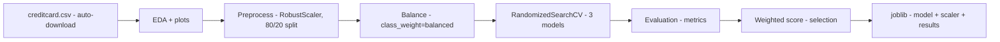

# deteccao-de-fraudes

**English** · [Português (Brasil)](README.md)

[](#) [](#) [](#) [](LICENSE)

## What it is

A **credit-card fraud detection** pipeline using machine learning. It trains 3 models (Logistic Regression, Random Forest and Extra Trees) on the well-known `creditcard.csv` dataset (284 thousand transactions, 492 frauds) and picks the best one through a weighted score. A machine-learning lab focused on imbalanced classes.

## Status

An ML laboratory. Re-run and verified by the agent on 31/10/2026: the full training completed in ~2.5 min and produced the metrics documented below.

## Features

- **Automatic dataset download** of `creditcard.csv` (TensorFlow Storage) with local caching.
- **EDA**: class distribution, top-10 correlations with the target, histograms and a heatmap (matplotlib/seaborn), plots saved to `plots/`.
- **Preprocessing**: duplicate removal, `RobustScaler` on `Amount`/`Time`, a stratified 80/20 split with `random_state=42`.
- **Balancing**: uses `class_weight='balanced'` (fallback when `imbalanced-learn`/SMOTE is not installed).
- **3 models** with hyperparameter tuning (`RandomizedSearchCV` + `StratifiedKFold`).
- **Metrics**: Accuracy, Precision, Recall, F1, ROC AUC, Specificity and Confusion Matrix.
- **Weighted-score selection**: Recall 40% + F1 30% + Precision 20% + Accuracy 10%.
- **joblib export**: best model, scaler and full results.
- **`inspecionar_modelo.py`**: loads and inspects the generated `.joblib` files.

## Architecture

Two Python scripts with no framework: `main.py` runs the pipeline end to end; `inspecionar_modelo.py` inspects the saved artifacts. The stages are modular functions inside `main.py` (load → EDA → preprocess → balance → train → evaluate → select → save).



## Stack

- Python 3.x
- pandas ≥ 2.0, numpy ≥ 1.24
- scikit-learn ≥ 1.3 (tested with 1.9.1)
- matplotlib ≥ 3.7, seaborn ≥ 0.12
- joblib (persistence)

## Repository layout

```
deteccao-de-fraudes/
├── main.py                # full pipeline (509 lines)
├── inspecionar_modelo.py  # .joblib inspection (286 lines)
├── requirements.txt
├── LICENSE                # MIT
└── (generated on run)     creditcard.csv · *.joblib · plots/
```

## Prerequisites and installation

```bash
pip install -r requirements.txt
```

The script downloads the dataset (~151 MB) on first run and reuses it from cache.

## How to run

```bash
python main.py
```

Writes the plots to `plots/` and saves `modelo_<name>.joblib`, `scaler.joblib` and `resultados_modelos.joblib` in the project folder.

```bash
python inspecionar_modelo.py
```

Lists and shows metrics for the `.joblib` files found in the current folder.

## Tests and quality

There are no automated tests in this repository (no test folder confirmed). Validation comes from the evaluation metrics produced by the pipeline itself.

### Real metrics (run by the agent, 31/10/2026)

Comparison table of the 3 models on the test split (56,746 records, 95 frauds):

| Model | Accuracy | Precision | Recall | F1 | ROC AUC | Time |
|-------|----------|-----------|--------|-----|---------|------|
| LogisticRegression | 0.9753 | 0.0563 | 0.8737 | 0.1057 | 0.9657 | 14.7 s |
| RandomForest | 0.9995 | 0.9583 | 0.7263 | 0.8263 | 0.9197 | 67.1 s |
| **ExtraTrees** (chosen) | 0.9996 | 0.9861 | 0.7474 | 0.8503 | 0.9303 | 39.6 s |

For the chosen model (ExtraTrees), the confusion matrix detected 71 of 95 frauds (Recall 0.7474) and only **1 false positive** out of 56,650 legitimate records.

**About the imbalance**: the dataset has 0.17% fraud (ratio ~578:1). High recall matters more than accuracy for catching fraud, which is why the selection favors Recall (40%) and F1 (30%). Honest note: Logistic Regression, with just 5.6% precision, produces many false positives; the forest ensembles balance better, though they lose some recall.

## Technical decisions and trade-offs

- **`class_weight='balanced'` instead of SMOTE by default**: runs without the extra `imbalanced-learn` dependency; SMOTE kicks in as a fallback if installed.
- **RobustScaler only on `Amount` and `Time`**: the `V1..V28` features are already anonymized and centered in the original dataset.
- **Weighted score to choose the model**: in fraud, catching the fraudster matters more than classifying the legitimate majority correctly.

## Known limitations and roadmap

- The `V1..V28` features are anonymous (PCA of the original dataset) — it is impossible to know what they mean.
- The minority class has only 492 examples; the forest model catches ~75% of frauds on the test split.
- There is no feature engineering and no time-series work; the `Time` label is not explored deeply.
- **Leakage risk**: the stratified split uses a random 80/20 with a fixed seed; as the dataset is anonymized and has no clear temporality, leakage between train and test is unlikely but was not specifically tested.

## Development process

An individual project by Kelvin Oliveira, built with orchestrated AI agents and reviewed by the author. The ML pipeline, the dataset curation and the review are the author's.

## License and author

MIT — Copyright (c) 2026 Kelvin Rebelo de Oliveira.

**Author**: [Kelvin Oliveira](https://github.com/KelvinOliveiraCode) · [Portfolio](https://kelvinoliveiracode.github.io/portfolio/)
