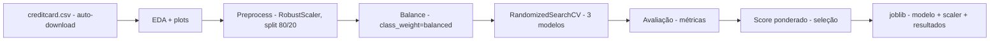

# deteccao-de-fraudes

[English](README.en.md) · **Português (Brasil)**

[](#) [](#) [](#) [](LICENSE)

## O que é

Pipeline de **detecção de fraude em cartão de crédito** com aprendizado de máquina. Treina 3 modelos (Regressão Logística, Random Forest e Extra Trees) sobre o clássico dataset `creditcard.csv` (284 mil transações, 492 fraudes) e seleciona o melhor por um score ponderado. Projeto de laboratório de ML, com foco didático em classes desbalanceadas.

## Status

Laboratório de aprendizado de máquina. Reprocessado e verificado pelo agente em 31/10/2026: treino completo rodou em ~2,5 min e gerou as métricas documentadas abaixo.

## Funcionalidades

- **Auto-download do dataset** `creditcard.csv` (TensorFlow Storage) com cache local.
- **EDA**: distribuição de classes, top-10 correlações com a variável alvo, histogramas e heatmap (matplotlib/seaborn), plots salvos em `plots/`.
- **Pré-processamento**: remoção de duplicatas, `RobustScaler` em `Amount`/`Time`, split estratificado 80/20 com `random_state=42`.
- **Balanceamento**: usa `class_weight='balanced'` (fallback quando `imbalanced-learn`/SMOTE não está instalado).
- **3 modelos** com ajuste de hiperparâmetros (`RandomizedSearchCV` + `StratifiedKFold`).
- **Métricas**: Accuracy, Precision, Recall, F1, ROC AUC, Specificity e Confusion Matrix.
- **Seleção por score ponderado**: Recall 40% + F1 30% + Precision 20% + Accuracy 10%.
- **Exportação via joblib**: melhor modelo, scaler e resultados completos.
- **`inspecionar_modelo.py`**: carrega e inspeciona os `.joblib` gerados.

## Arquitetura

Dois scripts Python sem framework: `main.py` executa o pipeline ponta a ponta; `inspecionar_modelo.py` inspeciona os artefatos salvos. As etapas são funções modulares dentro de `main.py` (carregar → EDA → pré-processar → balancear → treinar → avaliar → selecionar → salvar).



## Stack

- Python 3.x
- pandas ≥ 2.0, numpy ≥ 1.24
- scikit-learn ≥ 1.3 (testado com 1.9.1)
- matplotlib ≥ 3.7, seaborn ≥ 0.12
- joblib (persistência)

## Estrutura do repositório

```
deteccao-de-fraudes/
├── main.py                # pipeline completo (509 linhas)
├── inspecionar_modelo.py  # inspeção dos .joblib (286 linhas)
├── requirements.txt
├── LICENSE                # MIT
└── (gerados na execução)  creditcard.csv · *.joblib · plots/
```

## Pré-requisitos e instalação

```bash
pip install -r requirements.txt
```

O script baixa o dataset (~151 MB) na primeira execução e o reutiliza em cache.

## Como executar

```bash
python main.py
```

Gera os plots em `plots/` e salva `modelo_<nome>.joblib`, `scaler.joblib` e `resultados_modelos.joblib` na pasta do projeto.

```bash
python inspecionar_modelo.py
```

Lista e exibe métricas dos arquivos `.joblib` encontrados na pasta atual.

## Testes e qualidade

Não há testes automatizados neste repositório (ausência de pasta de testes confirmada). A validação é feita pelas métricas de avaliação do próprio pipeline.

### Métricas reais (executadas pelo agente, 31/10/2026)

Tabela comparativa dos 3 modelos sobre o split de teste (56.746 registros, 95 fraudes):

| Modelo | Accuracy | Precision | Recall | F1 | ROC AUC | Tempo |
|--------|----------|-----------|--------|-----|---------|-------|
| LogisticRegression | 0.9753 | 0.0563 | 0.8737 | 0.1057 | 0.9657 | 14,7 s |
| RandomForest | 0.9995 | 0.9583 | 0.7263 | 0.8263 | 0.9197 | 67,1 s |
| **ExtraTrees** (escolhido) | 0.9996 | 0.9861 | 0.7474 | 0.8503 | 0.9303 | 39,6 s |

No modelo escolhido (ExtraTrees), a matriz de confusão deu 71 fraudes detectadas de 95 (Recall 0.7474) e **1 falso positivo** em 56.650 legítimas.

**Sobre o desbalanceamento**: o dataset tem 0,17% de fraudes (razão ~578:1). Recall alto importa mais que acurácia para detectar fraude, por isso o critério de seleção prioriza Recall (40%) e F1 (30%). Nota honesta: a Regressão Logística, com apenas 5,6% de precisão, gera muitos falsos positivos; os ensembles florestais equilibram melhor, ainda que percam alguns recalls.

## Decisões técnicas e trade-offs

- **`class_weight='balanced'` em vez de SMOTE por padrão**: roda sem a dependência extra `imbalanced-learn`; SMOTE entra como fallback se instalado.
- **RobustScaler apenas em `Amount` e `Time`**: as demais features `V1..V28` já vêm anonimizadas e centradas do dataset original.
- **Score ponderado para escolher modelo**: em fraude, "pegar o fraudador" vale mais do que acertar a maioria legítima.

## Limitações conhecidas e roadmap

- As features `V1..V28` são anônimas (PCA do dataset original) — não dá para saber o que representam.
- A classe minoritária tem apenas 492 exemplos; o modelo florestal detecta ~75% das fraudes no split de teste.
- Não há engenharia de features nem séries temporais; o label `Time` não é explorado a fundo.
- **Risco de vazamento**: o split estratificado usa 80/20 aleatório com semente fixa; como o dataset é anonimizado e sem temporalidade clara, o vazamento entre treino/teste é pouco provável, mas não foi testado de forma específica.

## Processo de desenvolvimento

Projeto individual de Kelvin Oliveira, construído com agentes de IA orquestrados e revisado pelo autor. O pipeline de ML, a curadoria do dataset e a revisão são do autor.

## Licença e autor

MIT — Copyright (c) 2026 Kelvin Rebelo de Oliveira.

**Autor**: [Kelvin Oliveira](https://github.com/KelvinOliveiraCode) · [Portfólio](https://kelvinoliveiracode.github.io/portfolio/)
